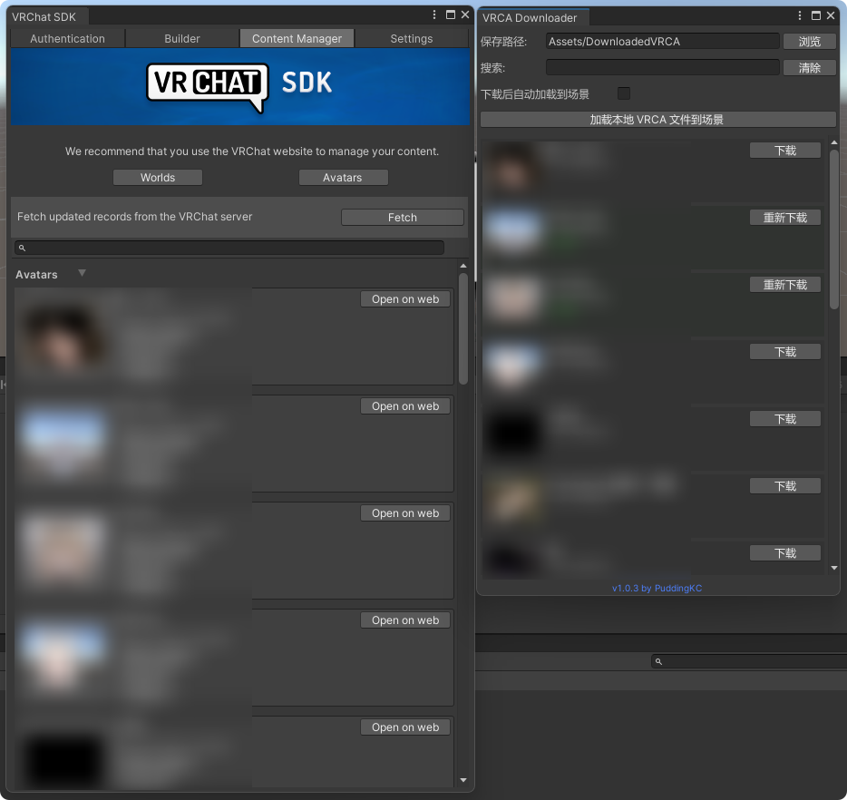

> [!WARNING]
>  # 严禁将本工具用于任何恶意用途。
> **本工具旨在帮助你找回属于自己的模型资产，请勿用于窃取他人资产。**

<h1 align="center">VRChat VRCA Downloader - Unity</h1>

  
  
  
  

  

## 插件简介
**VRChat VRCA Downloader - Unity** 是一个用于获取并下载你本人 VRChat 账号下 Avatar (.vrca) 文件的 Unity 插件。  

该工具基于 VRChat SDK 提供的接口获取模型列表，仅用于资源恢复场景。  
整个过程不会存储或上传你的账号信息，所有操作均在本地完成。

  

## 使用教程
使用前需要登录 VRChat SDK 并打开 `Content Manager` 页面加载一遍模型列表。

1. 打开 [Github Releases](https://github.com/Null-K/VRChatVRCADownloader-Unity/releases) 页面下载 `.unitypackage` 文件。
2. 双击下载的文件，在 Unity 中安装。
3. 安装后打开 `Tools -> VRCA Downloader` 即可使用。

## 免责声明

本工具为第三方辅助工具，**仅用于个人账号的模型资产管理与下载**。

- 所有数据请求均通过 VRChat 官方公开 API 完成
- 不包含对 VRChat 客户端、服务器或资源的任何注入或篡改
- 不存储、不上传、不分享用户账号密码或凭据至任何第三方
- 不提供也不支持任何绕过权限或非法访问的行为

**使用本工具产生的一切后果由使用者自行承担。**
